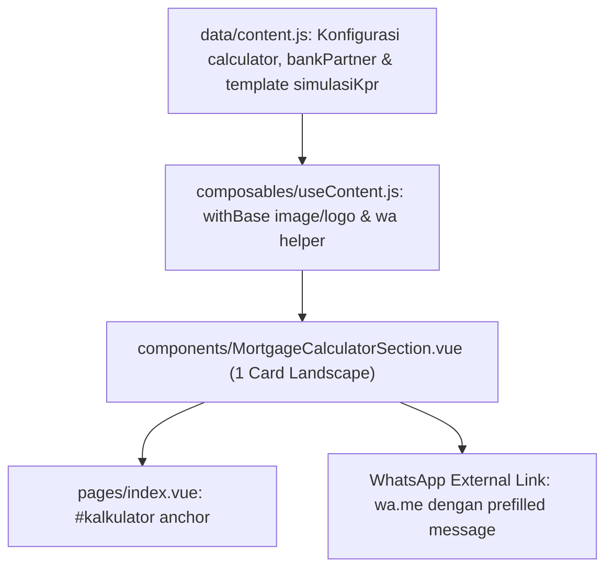

# Spec-Lite: Section Kalkulator Cicilan KPR (Simulasi Bunga Anuitas)

**Tanggal Pembuatan:** 2026-11-11  
**Pembaruan Terakhir:** 2026-11-11 (Logo Bank BCA & Disclaimer di Luar Card Utama)  
**Status:** Selesai (`PASS`)  
**Penulis / Agent:** `doc-agent`  
**Fitur:** Section Kalkulator Cicilan KPR Interaktif Sanggar Indah Palastri  

---

## 1. Latar Belakang & Tujuan

Dalam alur pertimbangan pembelian properti hunian di Sanggar Indah Palastri, calon pembeli memerlukan estimasi finansial yang jelas, cepat, dan transparan mengenai besaran uang muka (DP), plafon kredit, serta angsuran per bulan sebelum menghubungi tim representatif pemasaran.

### Tujuan Utama:
1. **Meningkatkan Konversi & Engagement:** Menghadirkan alat kalkulasi mandiri (*self-service mortgage calculator*) yang interaktif langsung pada landing page tanpa memerlukan reload halaman.
2. **Kemitraan Resmi KPR Bank BCA:** Mengintegrasikan penandaan resmi pembiayaan KPR Bank BCA dengan suku bunga anuitas 5% per tahun ($r = 0.05 / 12$ per bulan) yang presisi dan identik hingga satuan Rupiah terhadap acuan simulasi Excel resmi proyek perumahan.
3. **Mendorong Lead Generation Berkualitas:** Menyediakan tombol Call-to-Action (CTA) WhatsApp dinamis yang secara otomatis merangkum parameter simulasi pembeli (Harga Rumah, Uang Muka, Plafon, Tenor, dan Estimasi Cicilan) ke tim marketing Palastri.
4. **Harmonisasi Desain Visual & Tata Letak Landscape Terpadu:**
   - Menyatukan kalkulator ke dalam **1 Card Landscape 2 Kolom** terpadu yang seimbang, rapi, dan mudah dipindai di desktop maupun mobile.
   - **Pembersihan Ruang Internal:** Menghilangkan kotak kemitraan redundan di dalam card utama agar kolom hasil estimasi tetap lapang dan proporsional terhadap kolom input.
   - **Pill Container Kemitraan & Disclaimer Elegan:** Menempatkan logo resmi Bank BCA dan teks disclaimer ringkas di LUAR card utama cicilan sebagai pill/container berlatar *backdrop-blur* yang modern.
   - Memberikan kedalaman visual melalui latar belakang hunian 3D tipis (*opacity* 10–15%) dengan gradasi *fade* atas-bawah yang menyatu halus dengan palet *sage & paper* Palastri.

---

## 2. Arsitektur, Komponen & Desain Layout

### 2.1 Alur Data & Integrasi



### 2.2 Wireframe Arsitektur 1 Card Landscape & Pill BCA di Luar Card

```
┌────────────────────────────────────────────────────────────────────────────────────────┐
│ [Background: Gambar Hunian 3D Opacity 10-15% + Fade Gradient Atas & Bawah]             │
│                                                                                        │
│                               [Eyebrow: SIMULASI ANGSURAN]                             │
│                           Hitung Simulasi Cicilan Rumah Anda                           │
│              Rencanakan pembelian rumah impian Anda dengan mudah...                    │
│                                                                                        │
│  ┌─ SATU CARD LANDSCAPE 2 KOLOM (Rounded 26px, Shadow, Border Line) ────────────────┐  │
│  │                                                   │                              │  │
│  │  KOLOM 1 (KIRI, 6 Col): INPUT DATA                │  KOLOM 2 (KANAN, 6 Col):     │  │
│  │                                                   │  HASIL ESTIMASI & CTA        │  │
│  │  🏠 Harga Rumah                                   │  Plafon KPR:                 │  │
│  │  ┌──────────────────────────────────────────┬───┐ │    Rp 157.700.000            │  │
│  │  │ Rp 166.000.000                           │ ✕ │ │  ──────────────────────────  │  │
│  │  └──────────────────────────────────────────┴───┘ │  ┌─ BOX ESTIMASI CICILAN ──┐ │  │
│  │                                                   │  │ Estimasi Cicilan/Bulan  │ │  │
│  │  👛 Uang Muka (DP) - 5% (Rp 8.300.000)            │  │ Rp 1.040.750 /bulan     │ │  │
│  │  ┌────────────────────────┬─────────────────────┐ │  │ [ Bunga 5% Anuitas BCA ] │ │  │
│  │  │ Rp 8.300.000           │  5 %                │ │  └─────────────────────────┘ │  │
│  │  └────────────────────────┴─────────────────────┘ │  ┌─ 3 METRICS GRID ────────┐ │  │
│  │  [==●===========================================] │  │ Bunga     DP       Tenor │ │  │
│  │  5% Min DP                 50%       90% Max DP   │  │ 5.0% p.a. Mulai 5% 20 Th │ │  │
│  │                                                   │  └─────────────────────────┘ │  │
│  │  📅 Jangka Waktu Pinjaman                         │  ▾ Rincian Biaya Akad Awal   │  │
│  │  ┌──────────────────────────────────────────────┐ │    • Provisi (0.5%): Rp 788k │  │
│  │  │ 20 Tahun (240 Bulan)                       ▼ │ │    • Admin Bank: Rp 500k     │  │
│  │  └──────────────────────────────────────────────┘ │    • Total Biaya: Rp 2.329k  │  │
│  │                                                   │                              │  │
│  │                                                   │  [ 📲 Konsultasi WhatsApp ↗ ]│  │
│  └───────────────────────────────────────────────────┴──────────────────────────────┘  │
│                                                                                        │
│       ┌─ PILL CONTAINER DI LUAR CARD (White/80 Backdrop-blur, Border Line) ───┐        │
│       │ [ Logo BCA ] | *Simulasi cicilan bunga anuitas 5% ini khusus berlaku  │        │
│       │                untuk KPR Bank BCA. Persetujuan kredit dan biaya riil   │        │
│       │                mengikuti ketentuan bank.                              │        │
│       └───────────────────────────────────────────────────────────────────────┘        │
└────────────────────────────────────────────────────────────────────────────────────────┘
```

### 2.3 Rincian Komponen & Modul:

1. **`components/MortgageCalculatorSection.vue`**:
   - Komponen utama Vue 3 (`<script setup>`) terpadu:
     - **Kolom 1 (Kiri - `lg:col-span-6`):**
       - Input Harga Rumah: format angka otomatis dengan pemisah ribuan titik (`id-ID`), prefix `Rp`, dan tombol reset/clear `(✕)`.
       - Uang Muka (DP): sinkronisasi dua arah antara nominal Rupiah dan persentase %, serta *interactive range slider* (5% s/d 90%).
       - Jangka Waktu Pinjaman: dropdown pilihan tenor (5, 10, 15, 20 tahun / 60, 120, 180, 240 bulan).
     - **Kolom 2 (Kanan - `lg:col-span-6` dengan pembatas `lg:border-l lg:pl-10`):**
       - Ringkasan Plafon Pembiayaan KPR ($\text{Plafon} = \text{Harga} - \text{DP}$).
       - Box highlight estimasi cicilan dengan latar `bg-[var(--sage-pale)]/70`, angka cicilan tipografi serif besar, dan badge status suku bunga `"Bunga 5% Anuitas BCA"`.
       - Grid 3 metrik horizontal: Bunga KPR (`5.0% p.a.`), Uang Muka (`Mulai 5%`), dan Tenor KPR (`s/d 20 Thn`).
       - Collapsible accordion rincian biaya awal proses akad (Provisi 0.5%, Biaya Administrasi Rp 500.000, Total Biaya Pertama).
       - Tombol WhatsApp CTA *full-width* dengan generator pesan dinamis.
     - **Pembersihan Box Internal:** Tidak ada kotak kemitraan redundan di dalam card utama sehingga layout kolom kanan tetap seimbang, lapang, dan fokus pada estimasi angka serta tombol konversi.
   - **Pill Container Kemitraan & Disclaimer di Luar Card Utama:**
     - Diposisikan di bawah card (`mt-8 flex justify-center reveal`).
     - Menggunakan container pill/kapsul fleksibel (`bg-[var(--white)]/80 backdrop-blur-sm border border-[var(--line)] rounded-2xl sm:rounded-full px-5 py-2.5 sm:py-2 shadow-sm max-w-[820px]`).
     - Memuat logo resmi Bank BCA (`calc.bankPartner.logo`) dengan tinggi proporsional (`h-5 sm:h-6 w-auto`), pembatas vertikal halus (`hidden sm:block h-3.5 w-px bg-[var(--line)]`), dan teks disclaimer ringkas.
   - **Efek Visual Latar Belakang:** Layer `z-0` berupa gambar hunian 3D tipis (`opacity-10 lg:opacity-15`) dengan gradien fade atas-bawah (`bg-gradient-to-b from-[var(--paper)] via-transparent to-[var(--paper)]`).

2. **`data/content.js`**:
   - Node konfigurasi `calculator`:
     - Teks editorial: `eyebrow`, `title`, `titleLines`, `subtitle`
     - **Nilai Finansial Default Aktif:**
       - `defaultPrice: 166000000` (Rp 166 Jt)
       - `defaultDpPercent: 5` (5%)
       - `defaultTenor: 20` (20 Tahun)
       - `annualInterestRate: 0.05` (5% p.a.)
       - `provisionRate: 0.005` (0.5%)
       - `adminFee: 500000` (Rp 500.000)
     - **Data Kemitraan Bank BCA (`bankPartner`):**
       - `name: 'Bank BCA'`
       - `logo: '/assets/images/bank/bca.webp'`
       - `badge: 'Khusus KPR Bank BCA'`
       - `partnerTag: 'Mitra Resmi Pembiayaan'`
     - **Teks Disclaimer Ringkas (`footnote`):**
       `'*Simulasi cicilan bunga anuitas 5% ini khusus berlaku untuk KPR Bank BCA. Persetujuan kredit dan biaya riil mengikuti ketentuan bank.'`
     - Opsi tenor: `[5, 10, 15, 20]` tahun
     - Array metrik: Bunga KPR (5.0% p.a.), Uang Muka (Mulai 5%), Tenor KPR (s/d 20 Thn)
     - Label antarmuka lengkap (`labels.rateBadge: 'Bunga 5% Anuitas BCA'`, dsb.)
   - Template pesan WhatsApp di `meta.whatsappTemplates.simulasiKpr`:
     ```text
     Halo tim marketing Palastri, saya melakukan simulasi cicilan di website dengan rincian:
     - Harga Rumah: {harga}
     - Uang Muka: {dp} ({dpPercent}%)
     - Plafon KPR: {plafon}
     - Tenor: {tenor} Tahun
     - Estimasi Cicilan: {cicilan}/bulan

     Boleh bantu info ketersediaan unit dan persyaratan pengajuan KPR-nya?
     ```
   - Menu navigasi header di `meta.nav`: `{ id: 'kalkulator', label: 'Simulasi KPR' }`.

3. **`composables/useContent.js`**:
   - Normalisasi path gambar kalkulator melalui `withBase(content.calculator.image)`.
   - Normalisasi path logo Bank BCA melalui `withBase(content.calculator.bankPartner.logo)`.
   - Helper `wa('simulasiKpr', payload)` untuk URL WhatsApp dinamis yang terenkode rapi.

4. **`pages/index.vue`**:
   - Memasang `<MortgageCalculatorSection id="kalkulator" />` di antara `<ProductsSection />` dan `<WhySection />`.

---

## 3. Parameter Default Baru & Formula Matematika

### 3.1 Parameter Default Aktif Proyek (Program KPR Khusus Bank BCA)

| Parameter | Nilai Default | Keterangan |
|---|---|---|
| **Mitra Pembiayaan KPR** | **Bank BCA** | Program suku bunga khusus KPR BCA |
| **Harga Rumah** | **Rp 166.000.000** | Patokan harga hunian dasar/subsidi Palastri |
| **Persentase Uang Muka (DP)** | **5%** | Ambang batas minimal DP program KPR |
| **Nominal Uang Muka (DP)** | **Rp 8.300.000** | $5\% \times \text{Rp } 166.000.000$ |
| **Plafon Pembiayaan KPR** | **Rp 157.700.000** | $\text{Harga} - \text{DP}$ |
| **Tenor Kredit** | **20 Tahun (240 Bulan)** | Jangka waktu pembiayaan maksimal |
| **Suku Bunga KPR** | **5.0% per tahun** | Anuitas efektif ($r = 0.05 / 12$) |
| **Estimasi Cicilan per Bulan** | **Rp 1.040.750 /bulan** | Dihitung via rumus anuitas ($n = 240$) |
| **Biaya Provisi Bank (0.5%)** | **Rp 788.500** | $0.005 \times \text{Rp } 157.700.000$ |
| **Biaya Administrasi Bank** | **Rp 500.000** | Biaya administrasi flat |
| **Total Estimasi Biaya Pertama** | **Rp 2.329.250** | $\text{Cicilan } 1 + \text{Provisi} + \text{Admin}$ |

---

### 3.2 Formula Anuitas Bulanan

Formula perhitungan cicilan bulanan:

$$A = P \times \frac{r(1 + r)^n}{(1 + r)^n - 1}$$

Di mana:
- $A$ = Angsuran per bulan (Equated Monthly Installment)
- $P$ = Plafon Kredit KPR = $\text{Harga Rumah} - \text{Uang Muka}$
- $i$ = Suku bunga per tahun = $0.05$ ($5\%$ p.a.)
- $r$ = Suku bunga per bulan = $\frac{i}{12} = \frac{0.05}{12} \approx 0.0041666667$
- $n$ = Jumlah periode angsuran bulanan = $\text{Tenor (Tahun)} \times 12$

---

### 3.3 Tabel Verifikasi Presisi (Perbandingan vs Excel)

#### A. Verifikasi Plafon Acuan Excel ($P = \text{Rp } 243.650.000$, Bunga $5\%$ p.a.)
| Tenor Pinjaman ($n$) | Hasil Rumus Javascript (Vue) | Nilai Resmi di Excel Proyek | Selisih Presisi |
|---|---|---|---|
| **5 Tahun (60 Bulan)** | **Rp 4.597.976,08** | **Rp 4.597.976,08** | **Rp 0,00 (Identik 100%)** |
| **10 Tahun (120 Bulan)** | **Rp 2.584.286,28** | **Rp 2.584.286,28** | **Rp 0,00 (Identik 100%)** |
| **15 Tahun (180 Bulan)** | **Rp 1.926.768,67** | **Rp 1.926.768,67** | **Rp 0,00 (Identik 100%)** |
| **20 Tahun (240 Bulan)** | **Rp 1.607.982,16** | **Rp 1.607.982,16** | **Rp 0,00 (Identik 100%)** |

#### B. Perhitungan untuk Parameter Default Baru ($P = \text{Rp } 157.700.000$, Bunga $5\%$ p.a.)
| Tenor Pinjaman ($n$) | Angsuran Bulanan ($A$) | Biaya Provisi (0.5%) | Total Biaya Pertama |
|---|---|---|---|
| **5 Tahun (60 Bulan)** | **Rp 2.975.820 /bulan** | Rp 788.500 | Rp 4.264.320 |
| **10 Tahun (120 Bulan)** | **Rp 1.672.553 /bulan** | Rp 788.500 | Rp 2.961.053 |
| **15 Tahun (180 Bulan)** | **Rp 1.246.999 /bulan** | Rp 788.500 | Rp 2.535.499 |
| **20 Tahun (240 Bulan)** | **Rp 1.040.750 /bulan** | Rp 788.500 | Rp 2.329.250 |

---

## 4. Acceptance Criteria (Given / When / Then)

### Skenario 1: Tampilan Awal, Nilai Default Baru & Pill Bank BCA
- **Given** pengguna pertama kali membuka landing page dan menggulir ke section `#kalkulator`.
- **Then** kalkulator tampil dalam **1 Card Landscape 2 Kolom** yang seimbang tanpa box kemitraan internal di dalam kartu.
- **Then** form langsung terisi nilai default: Harga Rumah `Rp 166.000.000`, Uang Muka `5%` (`Rp 8.300.000`), Tenor `20 Tahun (240 Bulan)`.
- **Then** box estimasi otomatis menampilkan Plafon `Rp 157.700.000`, cicilan `Rp 1.040.750 /bulan`, dan badge `"Bunga 5% Anuitas BCA"`.
- **Then** di LUAR card utama bagian bawah terdapat pill/container elegan berlatar *backdrop-blur* yang menampilkan logo resmi Bank BCA bersama kalimat disclaimer ringkas:  
  *"*Simulasi cicilan bunga anuitas 5% ini khusus berlaku untuk KPR Bank BCA. Persetujuan kredit dan biaya riil mengikuti ketentuan bank.*"*.

### Skenario 2: Input Harga Manual & Reset Bebas
- **Given** pengguna ingin menghitung unit dengan harga lain.
- **When** pengguna memasukkan angka kustom (misal: `300000000`).
- **Then** field otomatis memformat teks menjadi `300.000.000`, nominal DP terhitung ulang sesuai persentase aktif, dan nominal cicilan langsung diperbarui.
- **When** pengguna mengklik tombol reset `(✕)` di sisi kanan input.
- **Then** harga rumah dikosongkan menjadi 0, nominal DP menjadi 0, dan perhitungan cicilan bulanan kembali ke Rp 0 tanpa memicu error `NaN`.

### Skenario 3: Sinkronisasi Dua Arah Uang Muka & Slider
- **Given** harga rumah bernilai Rp 166.000.000.
- **When** pengguna mengubah persentase DP menjadi `10%`.
- **Then** input nominal DP otomatis berubah menjadi `Rp 16.600.000` dan posisi slider bergerak ke 10%.
- **When** pengguna mengetik nominal DP manual menjadi `Rp 20.000.000`.
- **Then** persentase DP otomatis terhitung menjadi `12.0%` dan slider menyesuaikan posisinya.
- **When** pengguna menggeser slider DP dari 5% ke 25%.
- **Then** persentase dan nominal DP terupdate secara reaktif dan lancar tanpa hambatan.

### Skenario 4: Perubahan Tenor Pinjaman
- **Given** formulir simulasi terisi dengan plafon pembiayaan aktif.
- **When** pengguna memilih tenor lain (misal: `10 Tahun (120 Bulan)`) pada dropdown.
- **Then** estimasi cicilan per bulan di box highlight langsung berubah seketika menjadi `Rp 1.672.553 /bulan`.

### Skenario 5: Collapsible Rincian Biaya Akad Awal
- **Given** box estimasi cicilan menampilkan nilai cicilan aktif.
- **When** pengguna mengklik teks *"Lihat Rincian Biaya Akad Awal ▾"*.
- **Then** accordion membuka rincian: Provisi Bank 0.5% (`Rp 788.500`), Administrasi Bank (`Rp 500.000`), dan Total Estimasi Biaya Pertama (`Rp 2.329.250`).
- **When** pengguna mengklik teks *"Tutup Rincian Biaya Akad Awal ▴"*.
- **Then** area rincian biaya kembali tersembunyi (*collapsed*).

### Skenario 6: Integrasi Tombol WhatsApp Dinamis
- **Given** simulasi menampilkan hasil perhitungan (misal default: Rp 166 Jt, DP 5%, Tenor 20 Thn, Cicilan Rp 1.040.750).
- **When** pengguna mengklik tombol *"Konsultasi Simulasi via WhatsApp ↗"*.
- **Then** tab browser baru terbuka ke `https://wa.me/...` dengan pesan yang sudah terisi otomatis merangkum rincian simulasi tersebut ke WhatsApp tim marketing Palastri.

### Skenario 7: Responsivitas Mobile & Desktop
- **Given** pengguna membuka halaman pada layar desktop (≥1024px).
- **Then** card kalkulator tampil mendatar dalam 2 kolom berdampingan (Kolom 1 form input, Kolom 2 hasil estimasi & CTA).
- **Given** pengguna membuka halaman pada layar smartphone (375px atau 390px).
- **Then** layout card beralih menjadi 1 kolom vertikal (*stacked*) yang rapi, tanpa horizontal overflow, dan container pill BCA di luar card menyesuaikan menjadi stacked vertikal fleksibel.

---

## 5. Out of Scope (Batasan Fitur)

1. **Tidak Ada Modul Payment Gateway Online:** Pembayaran uang muka atau booking fee tidak dieksekusi secara elektronik di landing page.
2. **Tidak Ada Pengunggahan Berkas KPR Formal:** Pengumpulan dokumen formal (KTP, slip gaji, rekening koran) tetap dilakukan melalui konsultasi personal tim marketing dan bank.
3. **Tidak Menghubungkan Live API Bank:** Simulasi mengacu pada suku bunga kemitraan 5% p.a. anuitas BCA tetap yang telah ditentukan di `data/content.js`.
4. **Tidak Memasukkan Asuransi Jiwa & Kerugian:** Premi asuransi tidak dimasukkan dalam simulasi karena nilainya dinamis tergantung usia nasabah dan hasil appraisal bank.
